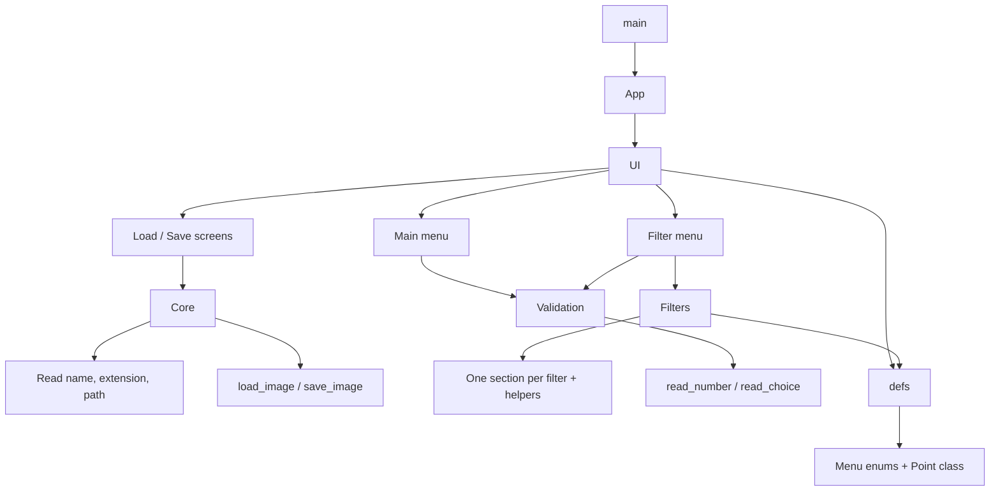
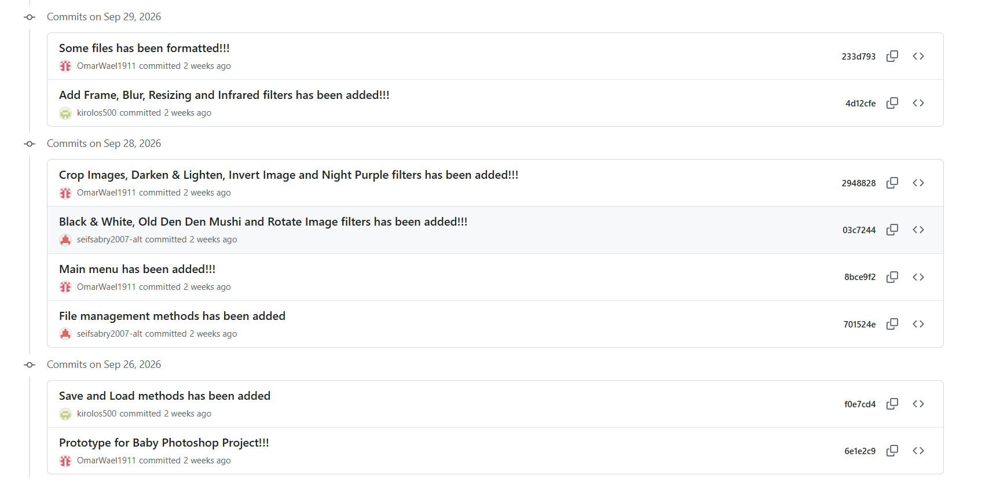
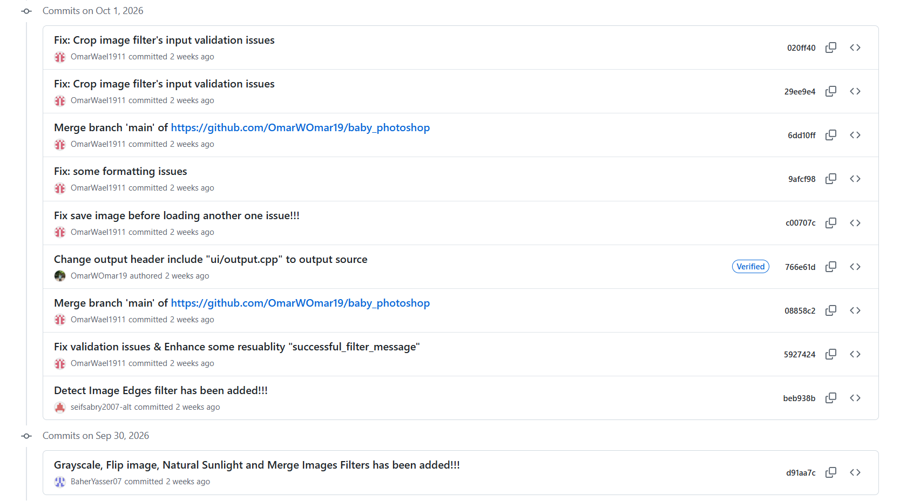
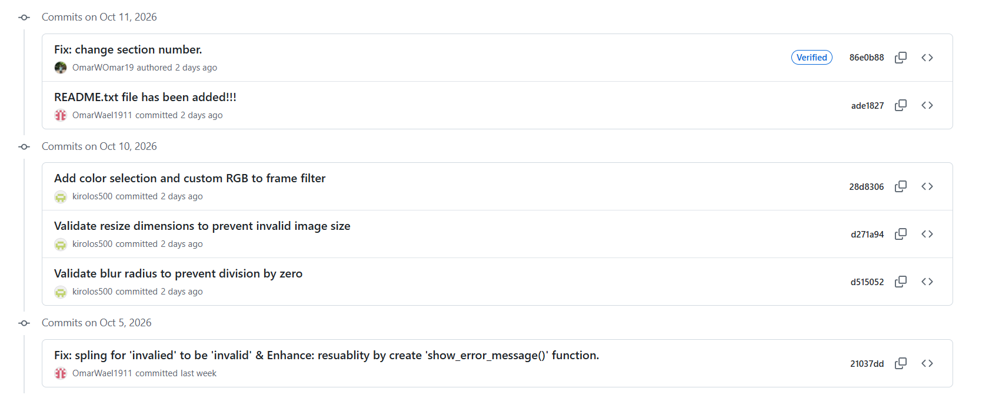

# Baby Photoshop

File        :  CS213_A1_Part2_S11_S12_20250114_20250315_20250444_20250503.cpp
Course      :  CS213 - Assignment 1 (Part 1 - 8 filters)

Baby Photoshop is a console application (no GUI) for basic image editing, built for CS213 Assignment 1. It uses the provided `Image_Class.h` library to read, modify and write images, and everything is driven by text menus.

## Team Members

| Name | ID | Filters |
|------|----|---------|
| Baher Yasser Ayad | 20250114 | Grayscale, Flip Image, Merge Two Images, Natural Sunlight |
| Seif Sabry Abd El-Salam | 20250315 | Black and White, Rotate Image, Detecting Image Edges, Old Den Den Mushi |
| Omar Wael Omar Abd Al-Latief | 20250444 | Invert Image, Darken & Lighten, Crop Images, Night Purple |
| Kirolos Nabil | 20250503 | Adding Frame, Resizing Image, Blur Image, Infrared |

## Who Did What

**Baher Yasser Ayad**
- Grayscale, Flip Image, Merge Two Images and Natural Sunlight filters

**Seif Sabry Abd El-Salam**
- Black and White, Rotate Image, Detecting Image Edges and Old Den Den Mushi filters
- File management methods

**Omar Wael Omar Abd Al-Latief**
- Invert Image, Darken & Lighten, Crop Images and Night Purple filters
- Project prototype and the main menu
- Input validation fixes, the `show_error_message()` and `successful_filter_message` helpers
- Fix for saving the image before loading another one
- Code formatting and this README

**Kirolos Nabil**
- Adding Frame, Resizing Image, Blur Image and Infrared filters
- Save and Load methods
- Validation for blur radius and resize dimensions, and color selection with custom RGB for the frame

## How the Program Works

1. **Main menu:** Load Image / Apply Filter / Save Image / Exit.
2. **Load Image:** the user enters an image path and the image is loaded into memory. If an unsaved image is already loaded, the program asks whether to save it first.
3. **Apply Filter:** the user picks one of the filters. Some filters ask for extra input (blur radius, crop points, rotation angle, frame size...). Filters can be applied one after another on the same image.
4. **Save Image:** the user enters a file name, extension and path to save the edited image.

## Available Filters

1. Grayscale
2. Black and White
3. Invert Image
4. Adding Frame (simple / decorative)
5. Flip Image (horizontal / vertical)
6. Rotate Image
7. Darken & Lighten
8. Resizing Image
9. Merge Two Images
10. Detect Image Edges
11. Crop Image
12. Blur Image
13. Natural Sunlight
14. Old Den Den Mushi
15. Night Purple
16. Infrared

## System Breakdown Diagram

- **defs:** enums for the main and filter menus, and a `Point` class used to read coordinates (crop filter).
- **filters:** one section per filter, each with its own helpers and a main function that takes the image by reference and modifies it.
- **Validation:** `read_number()` and `read_choice()` keep asking until the user enters a valid number or a choice in range.
- **Core:** reading the image name, extension and path, plus `load_image()` and `save_image()`.
- **UI:** the main menu, the filter menu, and the load / save screens.
- **App / main:** starts the program by showing the main menu.

## GitHub Snapshots

## Best & Hardest Part of the Assignment

- Best part of this project was building the structure of it form the beginning and it is also the hardest part.
